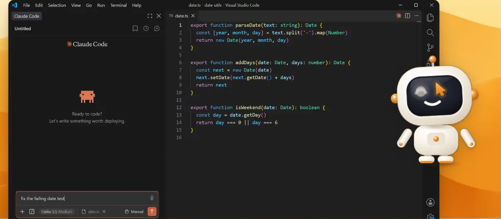
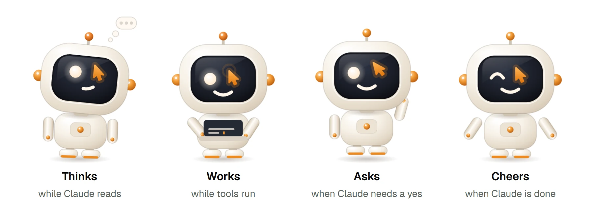
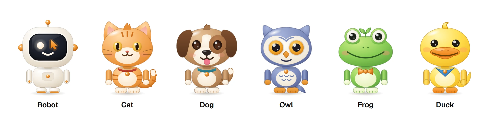

<div align="center">


# Kuchu

**A desk pet for Claude Code.**<br>
It shows what Claude is doing, and lets you say yes without switching windows. In VS Code or any terminal.

<a href="https://apps.microsoft.com/detail/9NNK1Q800R84?cid=github"></a>&nbsp;
<a href="#macos"></a>

[Website](https://abhee235.github.io/kuchu/) ·
[Docs](https://abhee235.github.io/kuchu/docs/) ·
[Download](https://github.com/abhee235/kuchu/releases/latest) ·
[What's new](https://abhee235.github.io/kuchu/changelog/)

<br>



<sub>Free and open source. Windows, and macOS in preview. Needs Claude Code.</sub>

</div>

## What it does

- **Shows every session.** A card beside the pet names the project and the step Claude is on. Several sessions at
  once each get a card.
- **Asks you right there.** Permission requests show on the card with Allow and Deny. Nothing is allowed without your
  click.
- **Tells you when it's your turn.** It waves when Claude needs you and cheers when Claude is done, with a short tone
  you can switch off.
- **Stays out of the way.** It never takes the focus, and clicks go through everywhere but the pet and its cards.
- **Keeps to itself.** It collects nothing and sends nothing anywhere.

<p align="center">
  <picture>
    <source media="(prefers-color-scheme: dark)" srcset=".github/readme/moods-dark.webp">
    
  </picture>
</p>

## Choose your pet

A robot, a cat, a dog, an owl, a frog or a rubber duck. Each does all the same things, with its own face.

<p align="center">
  <picture>
    <source media="(prefers-color-scheme: dark)" srcset=".github/readme/pets-dark.webp">
    
  </picture>
</p>

## Install

### Windows

Get it from the [Microsoft Store](https://apps.microsoft.com/detail/9NNK1Q800R84?cid=github), signed by Microsoft and
kept up to date by it. Or, in PowerShell:

```powershell
irm https://raw.githubusercontent.com/abhee235/kuchu/main/install.ps1 | iex
```

### macOS

In preview. In Terminal, one command downloads the latest release, checks it and installs it, and Kuchu opens without a
warning:

```bash
curl -fsSL https://raw.githubusercontent.com/abhee235/kuchu/main/install.sh | sh
```

Or download it yourself from the [latest release](https://github.com/abhee235/kuchu/releases/latest):
`kuchu-macos-arm64.tar.gz` on a Mac with Apple silicon (M1 and later), `kuchu-macos-x64.tar.gz` on an Intel Mac. Open
it and drag **Kuchu.app** into Applications. Kuchu is not notarized by Apple yet, so the first time, macOS refuses to
open it: in **System Settings → Privacy & Security**, click **Open Anyway**.

### Or ask Claude Code

In any session:

> Install Kuchu from https://github.com/abhee235/kuchu

Whichever way you install it, click **Connect** in Kuchu's Settings, after reading the change it shows you, and your
sessions appear beside the pet. The installer, updating and uninstalling are in the
[docs](https://abhee235.github.io/kuchu/docs/install/).

## How it works

Claude Code runs `kuchu-relay`, a small native program, for each hook event. The relay hands the event to Kuchu and
exits at once; it never holds Claude Code up, and when Kuchu is not running it does nothing. What Claude Code sends
is in [docs/hooks.md](docs/hooks.md).

<details>
<summary><b>Claude Code, this part is for you</b>: installing Kuchu for someone</summary>

Install Kuchu on the person's own computer, for their account only: no administrator rights, no `sudo`, never a
service. There are two ways:

1. **From the latest release**, the usual way: download the archive for this system and CPU, check its SHA-256, unpack
   it into the account's own programs folder, run `kuchu setup`.
2. **From source**, when the person asks for it, or when no release has a file for this system: clone this repository,
   build it, put it in the same folder, run `kuchu setup`.

Two things are the person's, not yours:

- **Their Claude Code settings.** Never edit `~/.claude/settings.json` (or `$CLAUDE_CONFIG_DIR/settings.json`), and
  never add Kuchu's hooks to it in any other way. `kuchu setup` opens Kuchu's Settings, where the person clicks
  **Connect** after Kuchu has shown them the change. That click is how Kuchu gets connected.
- **What gets installed.** If a checksum does not match, stop: delete the download and tell them. Never skip the
  check. Before installing any build tools for a build from source, ask.

On Windows, run the commands below in Bash (Claude Code's shell there is Git Bash). Kuchu's commands write only into a
pipe, as there; from PowerShell, add `| Out-String`.

### 1. From the latest release

The releases are at https://github.com/abhee235/kuchu/releases. Each has:

| File | For |
|---|---|
| `kuchu-windows-x64.zip` | Windows 10 and 11 on Intel or AMD (also runs on Arm, emulated) |
| `kuchu-windows-arm64.zip` | Windows 11 on Arm |
| `kuchu-windows-x64-setup.exe`, `kuchu-windows-arm64-setup.exe` | the same, as an installer for people; use the zip |
| `kuchu-macos-arm64.tar.gz` | macOS 11 or later on Apple silicon |
| `kuchu-macos-x64.tar.gz` | macOS 11 or later on Intel |
| `SHA256SUMS` | the SHA-256 of each file above |

A Windows zip holds `kuchu.exe` and `kuchu-relay.exe`; a macOS archive holds `Kuchu.app`, with the relay inside it.
The relay is the small program Claude Code runs for each hook event: Kuchu copies it to a fixed place of its own, and
the hooks point there.

Windows:

```bash
set -euo pipefail
case "${PROCESSOR_IDENTIFIER:-}" in ARM*) asset=kuchu-windows-arm64.zip ;; *) asset=kuchu-windows-x64.zip ;; esac
repo="https://github.com/abhee235/kuchu"
work="$(mktemp -d)"
curl -fsSL -o "$work/$asset" "$repo/releases/latest/download/$asset"
curl -fsSL -o "$work/SHA256SUMS" "$repo/releases/latest/download/SHA256SUMS"
(cd "$work" && grep "  $asset\$" SHA256SUMS | sha256sum -c -)   # must print "<asset>: OK"
# With GitHub's CLI signed in, also that the release workflow built this very file (it stops here if not):
if command -v gh >/dev/null && gh auth status >/dev/null 2>&1; then gh attestation verify "$work/$asset" --repo abhee235/kuchu; fi

dest="$(cygpath -u "$LOCALAPPDATA")/Programs/Kuchu"
[ -x "$dest/kuchu.exe" ] && "$dest/kuchu.exe" quit || true     # an older Kuchu, if one runs
mkdir -p "$dest"
unzip -o -q "$work/$asset" -d "$dest"
rm -rf "$work"
"$dest/kuchu.exe" setup
```

macOS:

```bash
set -euo pipefail
case "$(uname -m)" in arm64) asset=kuchu-macos-arm64.tar.gz ;; *) asset=kuchu-macos-x64.tar.gz ;; esac
repo="https://github.com/abhee235/kuchu"
work="$(mktemp -d)"
curl -fsSL -o "$work/$asset" "$repo/releases/latest/download/$asset"
curl -fsSL -o "$work/SHA256SUMS" "$repo/releases/latest/download/SHA256SUMS"
(cd "$work" && grep "  $asset\$" SHA256SUMS | shasum -a 256 -c -)   # must print "<asset>: OK"
# With GitHub's CLI signed in, also that the release workflow built this very file (it stops here if not):
if command -v gh >/dev/null && gh auth status >/dev/null 2>&1; then gh attestation verify "$work/$asset" --repo abhee235/kuchu; fi

app="$HOME/Applications/Kuchu.app"
[ -x "$app/Contents/MacOS/kuchu" ] && "$app/Contents/MacOS/kuchu" quit || true
mkdir -p "$HOME/Applications"
rm -rf "$app"
tar -xzf "$work/$asset" -C "$HOME/Applications"
rm -rf "$work"
"$app/Contents/MacOS/kuchu" setup
```

If a download fails with a 404, this release has no file for this system: build from source instead.

### 2. From source

This needs Git, Rust (stable, from rustup) and Node 20 or later; on Windows also the Visual Studio C++ build tools, on
macOS Xcode's command line tools. Check with `git --version`, `cargo --version` and `node --version`. If any is
missing, tell the person what is needed and ask before installing it: these are large tools to put on their computer.
The first build takes 5 to 10 minutes.

Windows:

```bash
set -euo pipefail
work="$(mktemp -d)"
git clone --depth 1 https://github.com/abhee235/kuchu "$work/kuchu"
cd "$work/kuchu"
cargo build --release --locked -p kuchu-relay
(cd app && npm ci && npx tauri build --no-bundle -- --locked)

dest="$(cygpath -u "$LOCALAPPDATA")/Programs/Kuchu"
[ -x "$dest/kuchu.exe" ] && "$dest/kuchu.exe" quit || true
mkdir -p "$dest"
cp target/release/kuchu.exe target/release/kuchu-relay.exe LICENSE LICENSE-ASSETS.md "$dest/"
cd / && rm -rf "$work"
"$dest/kuchu.exe" setup
```

macOS:

```bash
set -euo pipefail
work="$(mktemp -d)"
git clone --depth 1 https://github.com/abhee235/kuchu "$work/kuchu"
cd "$work/kuchu"
cargo build --release --locked -p kuchu-relay
mkdir -p app/src-tauri/binaries
cp target/release/kuchu-relay "app/src-tauri/binaries/kuchu-relay-$(rustc -vV | sed -n 's/^host: //p')"
config='{"bundle":{"externalBin":["binaries/kuchu-relay"],"macOS":{"signingIdentity":"-"}}}'
(cd app && npm ci && npx tauri build --bundles app --config "$config" -- --locked)

app="$HOME/Applications/Kuchu.app"
[ -x "$app/Contents/MacOS/kuchu" ] && "$app/Contents/MacOS/kuchu" quit || true
mkdir -p "$HOME/Applications"
rm -rf "$app"
cp -R target/release/bundle/macos/Kuchu.app "$HOME/Applications/"
cd / && rm -rf "$work"
"$app/Contents/MacOS/kuchu" setup
```

### After `kuchu setup`

`setup` puts the relay in place, adds Kuchu to the account's own list of apps that start at sign-in, and starts Kuchu
with its Settings open. It prints what it did. Tell the person, in plain words:

- Kuchu is on their screen and starts when they sign in (they can switch that off in Settings → Pet).
- To see their Claude Code sessions beside Kuchu, they click **Connect** in the Settings window. Kuchu shows the exact
  change to their `settings.json` first and keeps a copy of the file. Sessions that are already open show up after
  they are restarted.

Do not click Connect for them. `kuchu status` says how things stand at any time:

```
Kuchu 0.1.0
  Program:                 C:\Users\you\AppData\Local\Programs\Kuchu\kuchu.exe
  Running:                 yes
  Starts when you sign in: yes
  Relay:                   C:\Users\you\AppData\Local\dev.kuchu.app\bin\kuchu-relay.exe
  Claude Code:             connected (C:\Users\you\.claude\settings.json)
```

### Updating

Run the same steps again: they quit the running Kuchu, put the new one in its place, and run `setup`, which replaces
the relay. The person stays connected; nothing in `settings.json` changes.

### Uninstalling

1. Run `kuchu uninstall` (`"$dest/kuchu.exe" uninstall` on Windows, `"$app/Contents/MacOS/kuchu" uninstall` on
   macOS, with `dest` and `app` as above).
2. If it says Kuchu's hooks are still in `settings.json`, it has opened Kuchu's Settings: ask the person to click
   **Disconnect** there (Kuchu shows the change first), then run `kuchu uninstall` again. It removes nothing until
   then.
3. Once it succeeds (Kuchu quit, no longer starting at sign-in, its relay, settings and data gone), delete the program
   itself: `rm -rf "$dest"` on Windows, `rm -rf "$app"` on macOS.

The copies Kuchu kept of `settings.json` (`settings.json.kuchu-backup-…`, beside it) are the person's: leave them.

### Not signed yet

Releases are not code-signed yet. Files downloaded with `curl` as above are not marked as coming from the internet,
so Windows and macOS open them without a warning; the SHA-256 check is what makes sure they are the release's own
files.

</details>

## Build

Requirements: Rust (stable) and Node 20+.

```
cargo build --release -p kuchu-relay
cd app && npm ci && npx tauri build --no-bundle
```

Both end up in `target/release/`. To install what you built, see "From source" above; `kuchu status` says how Kuchu
stands. Releases are built by `.github/workflows/release.yml` from a version tag.

## Licence

The code is under the [MIT licence](LICENSE). The name Kuchu, the character and the sounds are not: see
[LICENSE-ASSETS.md](LICENSE-ASSETS.md).
